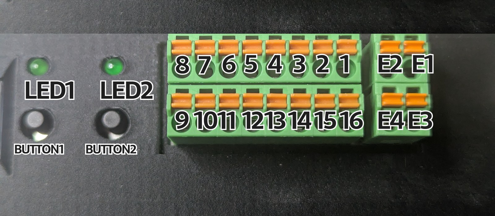

# RCB Mainboard Pin Map

Every GPIO signal on the control box, from the connector you wire into, through the Pi
header, to the shared-memory index the software reads.

## The connector panel



Terminals are spring-cage, in two rows. **The top row runs 8 down to 1 from left to right,
so terminal 1 is the rightmost**; the bottom row continues 9 to 16 left to right. The
separate two-by-two block on the right is the E-stop pair: E2/E1 on top, E4/E3 below.

Each E-stop is a **pair** of terminals, not one — E-Stop 1 is E2 + E4, E-Stop 2 is E1 + E3.

LEDs and buttons are labelled on the panel with the same names the code uses, so `LED1` in
the tables below is the LED silkscreened `LED1`.

The Connector pin column is filled in from this panel. Any blank cell means that signal is
not yet mapped to a terminal.

Source of truth for the Pi side: `hardware/gpio_handler.py` (pin constants) and
`data/shared_memory_index.py` (indices). If those change, change this file.

BCM is what the code uses — every constant in `gpio_handler.py` is a BCM number, and
`lgpio` / `gpiozero` both take BCM. Pi header pin is the physical position on the 40-pin
header, for probing with a meter.

**Every signal has two constants, and they are not interchangeable:**

| | where | what it holds | example |
|---|---|---|---|
| `<NAME>` | `data/shared_memory_index.py` | position in `gpio_states[]` | `ISOLATED_INPUT_1` = 0 |
| `<NAME>_PIN` | `hardware/gpio_handler.py` | BCM pin number | `ISOLATED_INPUT_1_PIN` = 19 |

The Constant column below gives `<NAME>`; append `_PIN` for the pin constant. Reading or
writing state uses `<NAME>` — see *Reading the state live* at the end. Only pin claiming
inside `gpio_handler.py` uses `<NAME>_PIN`, so most code never touches it.

---

## Isolated I/O

| Signal | Connector pin | Pi header pin | BCM | Direction | Constant | Index |
|---|---|---|---|---|---|---|
| Isolated In 1 | 11 | 35 | GPIO19 | in, pull-down | `ISOLATED_INPUT_1` | 0 |
| Isolated In 2 | 10 | 33 | GPIO13 | in, pull-down | `ISOLATED_INPUT_2` | 1 |
| Isolated In 3 | 9 | 26 | GPIO7 | in, pull-down | `ISOLATED_INPUT_3` | 2 |
| Isolated Out 1 | 6 | 22 | GPIO25 | out | `ISOLATED_OUTPUT_1` | 3 |
| Isolated Out 2 | 7 | 18 | GPIO24 | out | `ISOLATED_OUTPUT_2` | 4 |
| Isolated Out 3 | 8 | 15 | GPIO22 | out | `ISOLATED_OUTPUT_3` | 5 |

## E-stops

| Signal | Connector pin | Pi header pin | BCM | Direction | Constant | Index |
|---|---|---|---|---|---|---|
| E-Stop 1 | E2, E4 | 29 | GPIO5 | in, pull-down | `ESTOP_1` | 7 |
| E-Stop 2 | E1, E3 | 31 | GPIO6 | in, pull-down | `ESTOP_2` | 6 |

## General GPIO

| Signal | Connector pin | Pi header pin | BCM | Direction | Constant | Index |
|---|---|---|---|---|---|---|
| GPIO 1 |  | 7 | GPIO4 | in, pull-down | `GPIO_1` | 8 |
| GPIO 2 |  | 13 | GPIO27 | in, pull-down | `GPIO_2` | 9 |
| GPIO 3 |  | 12 | GPIO18 | in, pull-down | `GPIO_3` | 10 |
| GPIO 4 |  | 11 | GPIO17 | in, pull-down | `GPIO_4` | 11 |

## Front panel — LEDs and buttons

Owned by `supervisor.py` via gpiozero, not by RTI.

| Signal | Connector pin | Pi header pin | BCM | Direction | Constant | Index |
|---|---|---|---|---|---|---|
| LED 1 | LED1 | 36 | GPIO16 | out | `LED1` | 12 |
| LED 2 | LED2 | 38 | GPIO20 | out | `LED2` | 13 |
| Button 1 | BUTTON1 | 37 | GPIO26 | in | `BUTTON1` | 15 |
| Button 2 | BUTTON2 | 40 | GPIO21 | in | `BUTTON2` | 14 |

## Reserved by the buses — do not reuse

Claimed by kernel drivers through the overlays in `/boot/firmware/config.txt`. See
`system_setup/boot_config.txt`.

| Function | Connector pin | Pi header pin | BCM | Used by |
|---|---|---|---|---|
| I2C SDA |  | 3 | GPIO2 | SSD1306 OLED |
| I2C SCL |  | 5 | GPIO3 | SSD1306 OLED |
| UART TX |  | 8 | GPIO14 | mainboard PCB, 256000 baud |
| UART RX |  | 10 | GPIO15 | mainboard PCB, 256000 baud |
| SPI0 MOSI |  | 19 | GPIO10 | MCP2515 CAN |
| SPI0 MISO |  | 21 | GPIO9 | MCP2515 CAN |
| SPI0 SCLK |  | 23 | GPIO11 | MCP2515 CAN |
| SPI0 CE0 |  | 24 | GPIO8 | MCP2515 chip select |
| CAN INT |  | 32 | GPIO12 | MCP2515 interrupt (`interrupt=12` in config.txt) |

---

## Three things that bite

**1. Isolated In 3 is GPIO7, which is also SPI0 CE1.**
That one collision is why `config.txt` uses `dtoverlay=spi0-1cs` and not `dtparam=spi=on`.
The latter claims CE1 and RTI dies with an lgpio "GPIO busy". Header pin 26 sits directly
beside CE0 for the same reason. Full write-up in `docs/gpio_changes.md`.


**2. E-Stop 2 is deliberately ignored.**
`check_estop_active()` excludes it: it is a hardware fault that always reads as triggered.
Only E-Stop 1 (GPIO5) stops the robot. Anything that treats both as equivalent is wrong.

**3. Pin ownership is split, and the kernel enforces it.**
RTI claims the isolated I/O, E-stops and GPIO 1-4 through `lgpio`; supervisor claims the
LEDs and buttons through `gpiozero`. On Pi 5 a claim is exclusive, so if both processes
ever named the same pin, whichever started second would fail to init. Do not move a pin
between the two owners without moving it in both files.

The header is on `gpiochip4` on this image. `gpio_handler.py` tries chips 4, 0, 1, 2, 3 in
that order and honours `RCB_GPIO_CHIP` if you need to pin it.


---

## Reading the state live

`gpio_states` is a 16-element `uint8` array in shared memory, written by RTI every tick.
Any process can attach read-only:

```python
from data import shared_data
shared_data.setup(joints=6)
from data.shared_memory_index import ISOLATED_INPUT_1
print(int(shared_data.gpio_states[ISOLATED_INPUT_1]))
```

The dashboard's I/O tab shows all of it as badges, read-only. Outputs are driven only by
`set_digital_output(pin, value)` through the executor — nothing mirrors an input to an
output.
